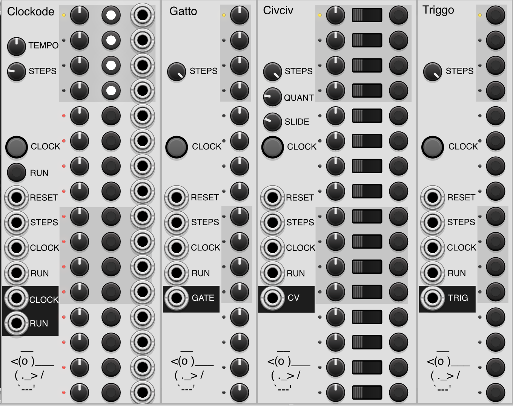

# Sparrows — VCV Rack Modules

**Sparrows** is a collection of free, open-source modules for [VCV Rack](https://vcvrack.com), built around a family of compact step sequencers.

Requires VCV Rack v2.4.0 or later.

## Modules

### Clockode
A 16-step **clock source with shiftable step timing**. It generates its own clock (adjustable Tempo, with CV control) or can be driven by an external clock, and outputs a trigger for each of the 16 steps. Step count is also CV-controllable.

### Gatto
A 16-step **gate sequencer** with variable step length. Each step has a trimmer to set its gate duration (0–100%), so you can go from tight ticks to overlapping legato gates. Gate output drives envelopes, or anything else that reacts to gates.

### Civciv
A 16-step **CV sequencer** for pitches, with per-step octave switches, quantization to semitones or microtonal scales (adjustable quantization setting), and a Slide (portamento) control with adjustable slide time. Outputs a CV signal.

### Triggo
A compact 16-step **trigger sequencer**. Click in a pattern, set the number of steps, and it fires triggers on the active steps — a simple and fast way to program percussion or rhythmic accents.

## Building and installing

This plugin uses the standard VCV Rack plugin build system. From the root of this repository, run:

```bash
make clean && make dep && make -j 16 && make dist && make install
```

This will:

1. `make clean` — remove previous build artifacts
2. `make dep` — download and build the plugin dependencies
3. `make -j 16` — compile the plugin (using 16 parallel jobs)
4. `make dist` — package the plugin into a distributable `.vcvplugin` file
5. `make install` — install the plugin into your local VCV Rack plugins folder

For more details, see the [official plugin build instructions](https://vcvrack.com/manual/Building#Building-Rack-plugins).

## Author

Created by [Marco Passerini](https://github.com/mpasserini).

## Donations

If you enjoy these modules, please consider supporting the author with a donation:

👉 [paypal.me/mp4ss](https://paypal.me/mp4ss)

## License

This plugin is licensed under the [GPL-3.0-or-later](LICENSE.md).

## Screenshot

